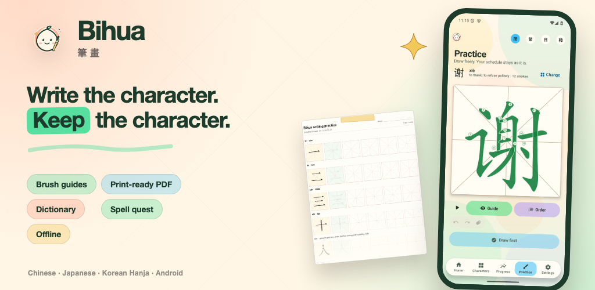
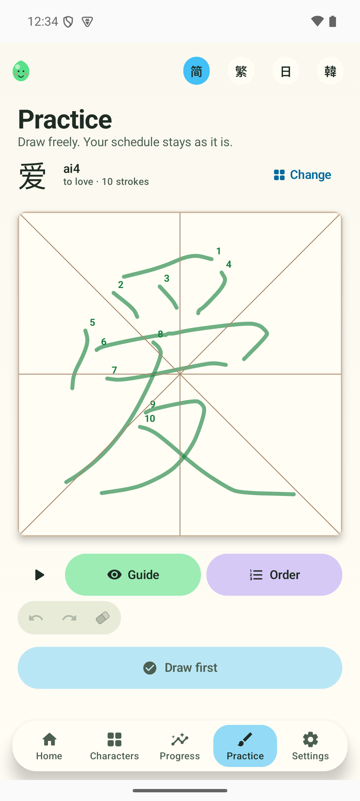
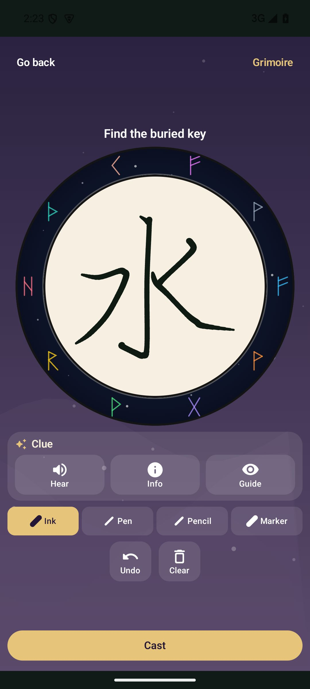

# Bihua 筆畫

[](https://github.com/Shadowsx3/bihua/actions/workflows/ci.yml)
[](LICENSE)
[](#requirements)
[](docs/ios-kmp-plan.md)
[](CHANGELOG.md)

**An offline, handwriting-first Android app for learning to write and read
Simplified Chinese, Traditional Chinese, Japanese, and Korean (Hangul and Hanja).**

The hand is the interface. Bihua asks the learner to produce a character from a
cue, fades the reference guide over time, and schedules the next review with
FSRS-7 or SBD. A stylus adds pressure; a finger or mouse also works. Writing and pronunciation are separate tasks. There is no account, no ads, and
no developer-run analytics.

<p align="center">
  
</p>

<p align="center">
  
  
  
</p>

<p align="center">
  <sub><b>Plan the day</b> &nbsp;·&nbsp; <b>Write from memory</b> &nbsp;·&nbsp; <b>Cast what you remember</b></sub>
</p>

<p align="center">
  <a href="https://shadowsx3.github.io/bihua/"><strong>Landing page</strong></a>
  ·
  <a href="https://shadowsx3.github.io/bihua/method.html"><strong>The method</strong></a>
  ·
  <a href="https://shadowsx3.github.io/bihua/#download"><strong>Download</strong></a>
</p>

## iOS port (in progress)

The same Compose Multiplatform client is being ported on the `ios/kmp` branch.
Android on `main` remains the shipped client. The plan, the shared architecture,
and the feature parity table live in `docs/ios-kmp-plan.md`,
`docs/ios-architecture.md`, and `docs/ios-feature-parity.md`. Build and run with
`make ios` or `make ios-ipad`. iPhone and iPad are the supported devices.

## New in 1.1.2

- **Today and Week ahead widgets.** The Today widget shows the day's reviews
  and lessons as done and total, with one plain next-hours line. A dedicated
  Week ahead widget shows the next seven days. Word of the Day stays its own
  card. They refresh at day-part and study-day boundaries, on app changes, and
  on clock/date changes.
- **Progress gained All time and a year map.** All time is a real window, not a
  renamed year. Year and All use a GitHub-style mint heatmap with month labels,
  a weekday gutter, a legend, and horizontal scrolling.
- **A report that stays yours.** Settings → About opens a composer with a kind
  chip, your words, and an optional saved crash. The preview shows exactly what
  will be sent, and Send opens your own mail or messenger. Crash files stay in
  app-private storage until then. Rate Bihua sits on the same quiet card.
- **A splash that does not jump.** The system splash and the in-app welcome use
  the same launcher art at the same size and centre, stay light in the dark
  theme, and no longer cover the welcome with the ink-reader notice.
- **Landscape phones.** Home uses the tablet two-page dashboard, Practice uses
  the book spread, and the spell quest, gate, draw screen, and grimoire use
  their wide layouts. The report sheet is centred and keeps its actions above
  the keyboard.
- **A guide you can trace over.** The spell-quest guide is the scene's chapter
  colour at 65% and sits under the learner's ink; the grimoire gift and result
  strokes drop their dark halo.
- **Offline from the first launch.** A clean device with no network can skip
  setup, open Home, and start a review while the optional reader downloads in
  the background.

From 1.1.1: the spell quest and its grimoire, the shared daily word, brush
presets, meaning checks, Reveal review, and study lists.

## Why it exists

Most character apps start with recognition: show a character and ask the learner
to tap a meaning. Bihua starts with production. Recognising 愛 is not the same
skill as writing it, and pronunciation is not the same skill again.

The design follows from that:

- **The character is the study item.** Words are context, not the scheduled unit.
- **Write from memory first.** The answer is not shown before the attempt.
- **The guide fades.** Full strokes, then outline, then nothing.
- **A memory model decides the date.** FSRS-7 or SBD. The learner decides the grade.
- **Two skills, two tasks.** Writing and pronunciation can be tested separately.
- **Local data.** Progress, notes, and history stay on the device.

Read the full rationale in [The Bihua method](docs/method.html).

## Features

| Area | What it does |
|---|---|
| **Scripts** | Simplified, Traditional, Japanese, Korean. Separate courses; script-pure content. |
| **Scheduling** | FSRS-7 or SBD, shared profile for shared glyphs, local weight fitting, a 70–97% target recall, 4 AM default day boundary, vacation mode, seven-day ease-back. |
| **Writing** | Introduce → Trace → Recall; guide fade; stroke order, shape, reversals, missing/extra strokes, and a focused correction loop. Each of the four tools keeps its own brush preset. Finger drawing is on by default; stylus-only is a choice. An optional Reveal review mode can show the answer instead. The reading model downloads once automatically on any connection, then works offline. |
| **Guided tour** | An optional live overlay over the real screens: the desk, reviews, grades, paper, search, and the spell road. Replay it from Settings → Help & tour. |
| **Progress** | 7-day, 30-day, 90-day, yearly, and All time windows for reviews, characters learned, practice time, pass rate, streak, best day, and daily rhythm. Year and All use a scrolling GitHub-style heatmap; every query is course-scoped and empty states stay honest. |
| **Meaning** | Optional character-to-meaning reviews: type a wording, reveal the clean gloss, see a real word, and grade. User synonyms are kept as accepted wordings. Off by default; Reveal review available. |
| **Reveal review** | Optional writing, pronunciation, and/or meaning reviews that show **Show answer** and then grade, with no canvas, keyboard, or choices. Independent switches; off by default. |
| **Pronunciation** | Separate review task; type pinyin, romaji or kana, or Hangul or romaja. |
| **Dictionary** | Reading, meaning, level, strokes, frequency, variants, radical, components, etymology, families, words, notes, history. A full-screen lookup opens any word into free writing practice. |
| **Spell quest** | Optional extra practice in all four courses: 1,387 spells, 10 chapters, and 35 families. Write a character that fits the scene, or take one from the grimoire. Every scene has several fitting answers, a whole-chapter door, or a rare exact-shape door; met pages stay in the book. Nothing is graded or scheduled. |
| **Word of the day** | One shared word per course and study day, chosen by the calendar rather than install time or a personal seed. The Home card and widget agree, and the word does not repeat inside a cycle. |
| **Home-screen widgets** | Today shows the day's done/total reviews and lessons with a plain next-hours line. Week ahead shows the next seven days. Word of the Day keeps its own card with Mò, the reading, meaning, and review/lesson counts. They refresh at day boundaries, on app changes, and on clock/date changes, with a six-hour fallback. |
| **Worksheets** | Print-ready A4 or Letter PDF from the course (start at any character number), picked characters, an imported .txt/.csv, study list, recently learned, recent mistakes, or confusion groups. Trace, two traces, model and copy, memory, trace only, alternate, and poster templates; configurable grid, boxes, page size, labels, and order. |
| **Transfer** | Word writing, paper checks, stroke-order rules, phonetic/semantic families. |
| **Study lists** | Named character and word lists, presets, streaming TXT/CSV/TSV/JSON import, `.txt` export, quick add, and list-only study. |
| **Theme** | System, Light, and Dark; cream ink on forest-night paper. |
| **Data** | Selective zip backup/import and encrypted local Wi-Fi sync (settings and/or progress), CSV export, no account, and a local-only report composer when something breaks. |
| **Reminders** | Optional daily study nudge, off by default, with a chosen hour and weekdays. |
| **Foldables, tablets, and landscape phones** | A book-style two-page inner layout on foldables, a two-page dashboard with a navigation rail on tablets, a two-page Home and book Practice in phone landscape, and the phone layout on the outer display. |

## Requirements

- Android 10+ (`minSdk 29`)
- ARM64 device
- JDK 17 and Android SDK 36 to build

## Install

The signed 1.1.2 test APK is on the [landing page](https://shadowsx3.github.io/bihua/#download).
The app is a private beta; read the release notes before installing. Uninstall a
Play copy first because the test build uses the local release key.

## Build from source

### Prerequisites

- JDK 17 (`java -version`)
- Android SDK Platform 36 and Build Tools (`ANDROID_HOME` set)
- `adb` and at least one Android 10+ device or emulator
- Python 3.11+ for the content tools and the optional journey harness
- macOS or Linux; the shell helpers are Bash

Put `ANDROID_HOME` in `local.properties` or the environment. `scripts/env.sh`
loads the SDK path, the Gradle wrapper, and the app's local debug/release paths.
Do not commit `local.properties`, `keystore.properties`, or any keystore.

```bash
source scripts/env.sh
make check       # compile, unit tests, content audit, debug APK, verification
make test        # unit tests only
make lint        # Android lint
make run         # check, install, and launch on a connected device
make smoke       # launch/navigation smoke test on a connected device
```

`make check` is the first command to run after a change. It fails on a missing
guide, a bad content row, a broken APK, or a unit-test regression before you
install anything.

### Release build

The release uses `keystore.properties` (ignored by git) with `storeFile`,
`storePassword`, `keyAlias`, and `keyPassword`. If the file is absent, the build
falls back to the debug key and is not a release candidate.

```bash
make release
. scripts/env.sh && ./gradlew :composeApp:bundleRelease
```

`make release` writes `composeApp/build/outputs/apk/release/app-release.apk`; the bundle
is `composeApp/build/outputs/bundle/release/app-release.aab`. Verify the signature and
version before hosting or uploading:

```bash
APKSIGNER=$(ls "$ANDROID_HOME"/build-tools/*/apksigner | tail -1)
"$APKSIGNER" verify --print-certs composeApp/build/outputs/apk/release/app-release.apk
adb install -r composeApp/build/outputs/apk/release/app-release.apk
```

Copy the APK to `docs/download/`, update `docs/download/SHA256SUMS.txt`, the
landing download hash, and `docs/play-store-submission.md`. The hosted APK is a
test build; Play upload waits for the current review to clear. The Play Console
answers, data-safety notes, permissions, and pre-upload checks live in
`docs/play-store-submission.md`.

GitHub Actions runs unit tests, the content audit, and lint. It does not assemble
or upload an APK.

### Journey harness

The QA harness drives the real app with UIAutomator on local emulators. It needs
the Android SDK, `adb`, Python 3.11+, and the AVDs named in `qa/profiles.json`.
The first run creates `.qa/venv` and installs its requirements.

```bash
scripts/journey.sh --quick --screenshots              # phone smoke matrix
scripts/journey.sh --standard --screenshots           # phone, fold, tablet core
scripts/journey.sh --spell --profile phone            # every spell-quest scenario
scripts/journey.sh --full --screenshots               # every profile and state
scripts/journey.sh --scenario spell-quest --profile phone --font-scale 1.5
```

Runs land in `.qa/runs/<timestamp>/`; each scenario has screenshots, a
`result.json`, and on failure `failed.png`, `failed.xml`, and `logcat.txt`.
Journeys are local, not CI: they need emulators and time. See `qa/README.md` for
the runner, profiles, and scenario list.

## Content

- Simplified: **3,180** (3,088 HSK 3.0 + 92 Non-HSK)
- Traditional: **3,163**
- Japanese: **2,286** (2,136 Jōyō + 150 kana)
- Korean: **2,239** (1,800 Hanja + 40 jamo + 399 syllables)
- **34,362** word examples
- **4,875** unique structure records
- Content version **34**

The content database is generated, not hand-edited:

```bash
tools/fetch-content.sh
python3 tools/import/build_content_db.py
make audit
```

The screen and user-journey risk list is
[`docs/archive/user-journey-risk-audit.md`](docs/archive/user-journey-risk-audit.md). The flow to
test mapping, including the on-device smoke pass, is
[`docs/test-matrix.md`](docs/test-matrix.md). The local daily-state harness is
[`qa/README.md`](qa/README.md). The learning-science and joy proposals are in
[`docs/learning-proposals.md`](docs/learning-proposals.md).

`tools/data/manifest.json` records the URL, checksum, licence, and count for each
source. Raw datasets are not committed. Korean Hanja comes from Unihan. Korean
word examples come from the Korean Wiktionary extract, ranked by FrequencyWords.

## Repository map

```text
composeApp/                 Android app
docs/                landing page and methodology
licenses/            full third-party licence texts
tools/import/        content importer and generator
tools/data/          source manifest (raw data ignored)
scripts/             build, device, release, smoke helpers
qa/                  local full-app journey harness
.github/             CI, issue templates, Dependabot
```

## Credits and scheduling research

Bihua stands on open research and open content. Thank you to:

- **Jarrett Ye** and the **open-spaced-repetition** contributors for FSRS and the
  public scheduler benchmark.
- **A. Schill** for SBD (Stability, Brittleness, Difficulty), *Interpretable
  Memory Models for Spaced Repetition* (2026),
  <https://doi.org/10.5281/zenodo.22727105>.
- The character, dictionary, stroke, and frequency sources credited in
  [THIRD_PARTY_NOTICES.md](THIRD_PARTY_NOTICES.md) and in Settings → About.

Android TextToSpeech reads aloud with an installed on-device voice. There is no
cloud speech service.

## Privacy

No account, no developer-run analytics, no advertising SDK. Progress and notes
live in a local SQLite database. Network access is used for handwriting-model
downloads, Google ML Kit diagnostics, and optional local Wi-Fi sync, which uses
TLS. Study reminders are local and off by default. See
[PRIVACY.md](PRIVACY.md) and the
[privacy page](https://shadowsx3.github.io/bihua/privacy.html).

## Licensing

The application code is **MIT-licensed**; see [LICENSE](LICENSE).

The bundled content database is a compilation with separate terms:

- CC BY-SA 4.0 portions from HSK 3.0 and CC-CEDICT;
- Make Me a Hanzi graphics under the Arphic Public License;
- Make Me a Hanzi dictionary under LGPL-3.0-or-later;
- KanjiVG under CC BY-SA 3.0;
- KANJIDIC2 and JMdict under CC BY-SA 4.0;
- Unihan under the Unicode License V3;
- ivankra/hsk30 under MIT.

Full attribution is in [THIRD_PARTY_NOTICES.md](THIRD_PARTY_NOTICES.md) and
[`licenses/`](licenses/). The same notices are bundled in the app under
**Settings → About → Licences and sources**.

## Contributing

Read [CONTRIBUTING.md](CONTRIBUTING.md) and [AGENTS.md](AGENTS.md) before changing
code or content.

- Branch from `main`, keep commits focused, and describe the user-visible change.
- Run `make check` and `make lint`; run the matching journey when a screen or
  flow changes. A fix without a test or a journey update is incomplete.
- Keep generated content separate from authored copy. `tools/spells/parts.sql`
  and `tools/spells/spell_catalog.py` are the authored sources; the CSV and DB
  are built artifacts.
- Do not commit keystores, `local.properties`, raw datasets, `.qa/runs`, or
  `store/` assets. They are ignored on purpose.
- Update the README, changelog, test matrix, and release checklist when a
  feature, count, version, or flow changes.
- For content fixes, check the source, rebuild the database, run `make audit`,
  and keep the evidence in the commit message.
- For security issues, use [private reporting](https://github.com/Shadowsx3/bihua/security/advisories/new),
  not a public issue.

## Status

**1.1.1 is live on Play.** The current development version is **1.1.2
(versionCode 23)**. It adds Today and Week ahead widgets, All time and a
GitHub-style year heatmap, a local report composer with an optional saved
crash, a splash that no longer jumps, and two-page landscape layouts for Home,
Practice, the spell quest, its draw screen, and the grimoire.

New learners start with five new characters a day, reviews are mixed with new
lessons, and the session progress bar fills to the next lesson. The app also has
encrypted local sync, off-by-default study reminders, and foldable book layouts.

The phone, tablet, and foldable paths are checked at normal and 1.5x text. The
journey harness covers onboarding, daily queues, process death, fold changes,
dictionary, worksheet export, paper/Compare, study lists, appearance,
Word of the Day audio, Reveal reviews, the spell quest in all four scripts,
and a walk through every Settings section and overlay. A full TalkBack sweep at 2x and a current physical stylus
pass remain on the roadmap. The app is not a clinical intervention or a
guarantee of literacy.

Made with ❤️ from 🇺🇾 Uruguay.
