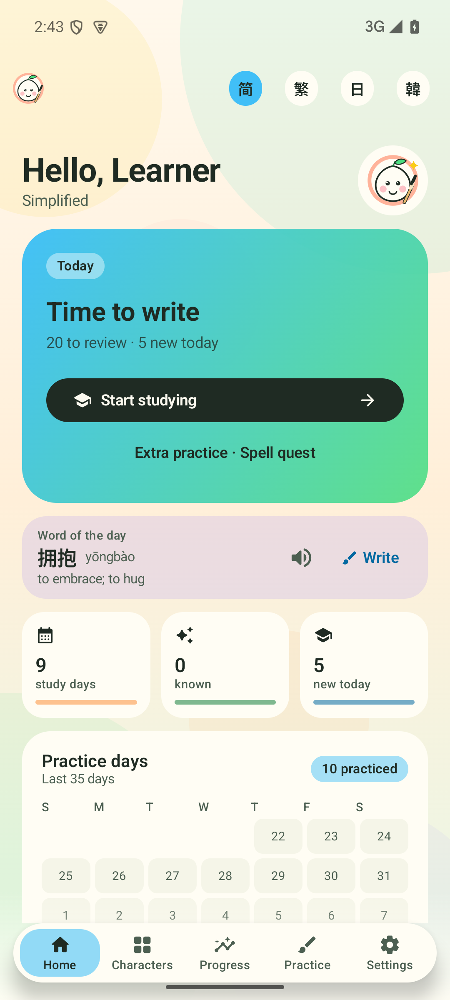
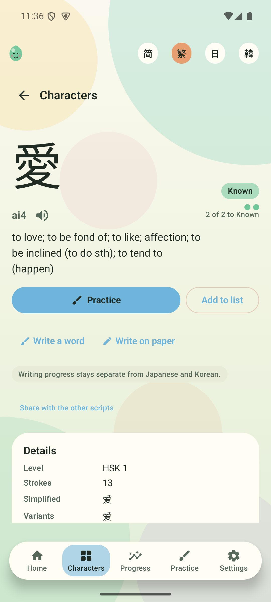
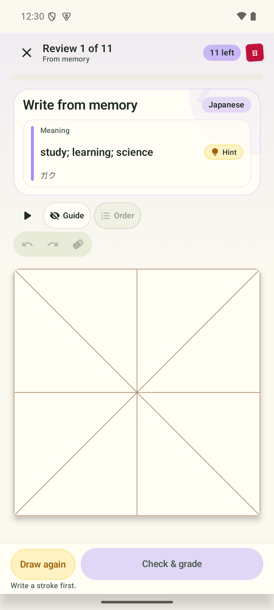

# Bihua 筆畫

[](https://github.com/Shadowsx3/bihua/actions/workflows/ci.yml)
[](LICENSE)
[](#requirements)
[](CHANGELOG.md)

**An offline, handwriting-first Android app for learning to write and read
Simplified Chinese, Traditional Chinese, Japanese, and Korean (Hangul and Hanja).**

The hand is the interface. Bihua asks the learner to produce a character from a
cue, fades the reference guide over time, and schedules the next review with
FSRS-7. A stylus adds pressure; a finger or mouse also works. Writing and pronunciation are separate tasks. There is no account, no ads, and
no developer-run analytics.

<p align="center">
  
  
  
  
</p>

<p align="center">
  <a href="https://shadowsx3.github.io/bihua/"><strong>Landing page</strong></a>
  ·
  <a href="https://shadowsx3.github.io/bihua/method.html"><strong>The method</strong></a>
  ·
  <a href="https://github.com/Shadowsx3/bihua/releases/latest"><strong>Download</strong></a>
</p>

## Why it exists

Most character apps start with recognition: show a character and ask the learner
to tap a meaning. Bihua starts with production. Recognising 愛 is not the same
skill as writing it, and pronunciation is not the same skill again.

The design follows from that:

- **The character is the study item.** Words are context, not the scheduled unit.
- **Write from memory first.** The answer is not shown before the attempt.
- **The guide fades.** Full strokes, then outline, then nothing.
- **FSRS-7 decides the date.** The learner decides the grade.
- **Two skills, two tasks.** Writing and pronunciation can be tested separately.
- **Local data.** Progress, notes, and history stay on the device.

Read the full rationale in [The Bihua method](docs/method.html).

## Features

| Area | What it does |
|---|---|
| **Scripts** | Simplified, Traditional, Japanese, Korean. Separate courses; script-pure content. |
| **Scheduling** | FSRS-7 per script, shared profile for shared glyphs, local weight fitting or import, 4 AM default day boundary, vacation mode, seven-day ease-back. |
| **Writing** | Introduce → Trace → Recall; guide fade; stroke order, shape, reversals, missing/extra strokes, and a focused correction loop. |
| **Pronunciation** | Separate review task; type pinyin, romaji or kana, or Hangul or romaja. |
| **Dictionary** | Reading, meaning, level, strokes, frequency, variants, radical, components, etymology, families, words, notes, history. |
| **Transfer** | Word writing, paper checks, stroke-order rules, phonetic/semantic families. |
| **Theme** | System, Light, and Dark; cream ink on forest-night paper. |
| **Data** | Selective zip backup/import and local Wi-Fi sync (settings and/or progress), CSV export, no account. |

## Requirements

- Android 10+ (`minSdk 29`)
- ARM64 device
- JDK 17 and Android SDK 36 to build

## Install

The latest signed APK is on the [releases page](https://github.com/Shadowsx3/bihua/releases/latest).
The app is a private beta; read the release notes before installing.

## Build

```bash
source scripts/env.sh
make check      # compile, 214 unit tests, content audit, debug APK, verification
make lint       # Android lint
make run        # check, install, and launch on a connected device
make smoke      # launch/navigation smoke test on a connected device
make release    # signed minified APK when keystore.properties is present
```

The release build is signed with a local upload key. Keystores and
`keystore.properties` are ignored by git. See [PUBLISHING.md](PUBLISHING.md) for
the release process.

GitHub Actions runs unit tests, the content audit, and lint. It does not assemble
or upload an APK.

## Content

- Simplified: **3,180** (3,088 HSK 3.0 + 92 Non-HSK)
- Traditional: **3,163**
- Japanese: **2,286** (2,136 Jōyō + 150 kana)
- Korean: **2,239** (1,800 Hanja + 40 jamo + 399 syllables)
- **34,362** word examples
- **4,875** unique structure records
- Content version **34**

The content database is generated, not hand-edited:

```bash
tools/fetch-content.sh
python3 tools/import/build_content_db.py
make audit
```

The screen and user-journey risk list is
[`docs/user-journey-risk-audit.md`](docs/user-journey-risk-audit.md).

`tools/data/manifest.json` records the URL, checksum, licence, and count for each
source. Raw datasets are not committed. Korean Hanja comes from Unihan. Korean
word examples come from the Korean Wiktionary extract, ranked by FrequencyWords.

## Repository map

```text
app/                 Android app
docs/                landing page and methodology
licenses/            full third-party licence texts
tools/import/        content importer and generator
tools/data/          source manifest (raw data ignored)
scripts/             build, device, release, smoke helpers
.github/             CI, issue templates, Dependabot
```

## Privacy

No account, no developer-run analytics, no advertising SDK. Progress and notes
live in a local SQLite database. Network access is used for handwriting-model
downloads, Google ML Kit diagnostics, and optional local Wi-Fi sync. See
[PRIVACY.md](PRIVACY.md) and the [public policy](https://shadowsx3.github.io/bihua/privacy.html).

## Licensing

The application code is **MIT-licensed**; see [LICENSE](LICENSE).

The bundled content database is a compilation with separate terms:

- CC BY-SA 4.0 portions from HSK 3.0 and CC-CEDICT;
- Make Me a Hanzi graphics under the Arphic Public License;
- Make Me a Hanzi dictionary under LGPL-3.0-or-later;
- KanjiVG under CC BY-SA 3.0;
- KANJIDIC2 and JMdict under CC BY-SA 4.0;
- Unihan under the Unicode License V3;
- ivankra/hsk30 under MIT.

Full attribution is in [THIRD_PARTY_NOTICES.md](THIRD_PARTY_NOTICES.md) and
[`licenses/`](licenses/). The same notices are bundled in the app under
**Settings → About → Licences and sources**.

## Contributing

Read [CONTRIBUTING.md](CONTRIBUTING.md). For security issues, use
[private reporting](https://github.com/Shadowsx3/bihua/security/advisories/new),
not a public issue.

## Status

Bihua 1.0.3 is the current closed test. 1.0.4 is ready for the next closed test:
a clearer review flow, common words on new characters, Korean word examples,
script filters, Japanese ruby, Korean romanization, cleaner readings, and better
Japanese word ordering. Explicit dictionary examples are tagged and hidden until
the learner turns on Mature words. The public APK stays at 1.0.3 until 1.0.4 is
promoted.

The phone and tablet paths are verified; a TalkBack/large-text audit and a
current physical S Pen pass remain on the roadmap. The app is not a clinical
intervention or a guarantee of literacy.
